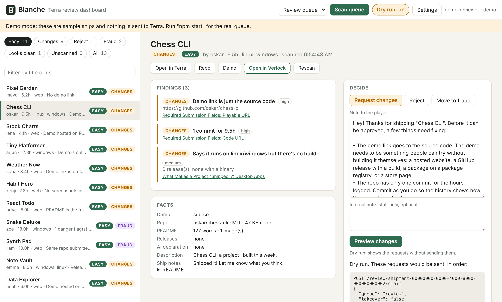
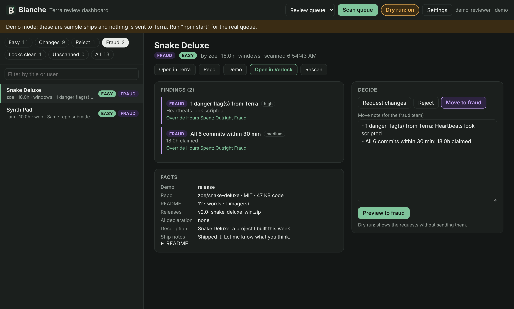

# Blanche

A review dashboard for [Hack Club Terra](https://terra.hackclub.com) that catches the easy reviews.

Blanche scans the review queue and checks every ship against the
[YSWS Project Submission Guidelines](https://hackclub.gitbook.io/ysws-project-submission-guidelines).
It looks for missing or broken demo links, demos that are just the repo or a video, disallowed hosts,
READMEs that are missing, too short, still a template or without a screenshot, school assignments,
and fraud signals in Terra's evidence. Ships are sorted into buckets with a drafted note for the
player, so the clear-cut ones take a glance and one click. For the rest, **Open in Verlock** runs
the repo in a throwaway desktop on [verlock.hackclub.dev](https://verlock.hackclub.dev).



## Quick start

Needs Node 20 or newer. There are no dependencies to install.

```sh
npm run demo     # sample ships, nothing leaves your machine
npm start        # the real Terra queue
```

Open http://127.0.0.1:8790. For the real queue, open **Settings** and paste your Terra token. To get it,
run `copy(localStorage.terra_auth_token)` in the browser console on terra.hackclub.com. Your account needs
the reviewer role. Adding a GitHub token (any token with public read access) is strongly recommended:
without one GitHub allows 60 requests an hour, which is about 15 ships.

Tokens are saved in `.blanche/config.json` (git-ignored, mode 600). You can also set `TERRA_TOKEN` and
`GITHUB_TOKEN` as environment variables.

## How it works

1. **Scan queue** loads each waiting ship from Terra, reads the repo from GitHub (README, releases,
   languages, fork), and opens the demo link like a reviewer would.
2. The rules in [`server/rules.js`](server/rules.js) turn that into findings. Each finding has a verdict, a
   confidence level, and a link to the guideline it comes from.
3. Ships land in buckets: **Changes**, **Reject**, **Fraud** or **Looks clean**. **Easy** collects the
   ships where the deciding finding is high confidence and nothing points the other way.
4. **Journals & commits** shows the player's journals with the commits tagged to each one, plus any
   commits no journal claims. Switch to **Commit history** for every commit, newest first, labelled
   with its journal. Open a commit for a short diff from GitHub (biggest files first, 24 lines each).
5. **Commit evidence** (in the spirit of [Introspect](https://introspect.sahil.ink)) sorts the commits into
   code, README-only, GitHub web uploads, merges and vague messages, and shows commits per claimed hour,
   the biggest commit's share of the code, and coding time on days with no commits. Two aligned charts
   put Hackatime's coding time per day next to commits (or lines) per day; hover a day for both, or open
   the table. It all comes from Terra's evidence, so it costs no extra requests. The thresholds are
   Blanche's own (Settings defaults in `server/rules.js`); Introspect's aren't public.
6. Pick a ship, edit the drafted note, and send **Request changes**, **Reject** or **Move to fraud**.
   Blanche claims the ship and then sends the decision, the same requests the Terra review page makes.
7. When Blanche got a finding wrong, press **Ignore** on it (with an optional reason). Ignored findings
   stop counting, so the ship moves buckets; **Undo** brings it back. Once nothing blocks it any more,
   **Approve** opens with a drafted justification (the facts above, with [bracketed] gaps Blanche won't
   send until you fill them): attach the test video, say what they built and how you tested it, acknowledge any
   Terra danger flags, and set the multiplier and any hours cut. Blanche claims the ship, acknowledges the
   flags, uploads the video and approves, checking the same rules as Terra's review page first.

| Catches | Verdict | Guideline |
| --- | --- | --- |
| No demo link · demo is the repo · localhost / tunnel URL · notebook (Colab, Jupyter) | changes | Playable URL |
| Demo hosted on Streamlit or Render, or on Google Drive · demo takes over 30s to load | changes | Disallowed Hosts |
| Demo is only a video (software only; hardware is fine) | changes | Playable URL |
| Demo link returns 404/410/5xx or the domain doesn't exist · goes straight to a login page | changes | Playable URL |
| Release with only source code · says Windows/Linux/macOS but no build | changes | Desktop Apps |
| Repo private or missing · no README · README is a framework template · too short · no how-to · no screenshot | changes | Code URL, Reproducibility |
| No screenshot on the ship, or it's a GIF/video · no description | changes | Screenshot, Description |
| One commit for 3h+ of work | changes | Code URL |
| School assignment wording · LeetCode-style solutions | reject | Project Exceptions |
| Undismissed Terra danger flags · same repo in another YSWS program (not an update) | fraud | Duplicates, Outright Fraud |
| Fork · tiny repo for many hours · all commits within an hour · mostly AI time with no declaration · time on files never in the repo | fraud | Inflated Hours, AI |
| Outside hackathon · tutorial wording · repo owner isn't the player · 3+ change rounds · fraud already suggested a cut | note only | |
| Few commits for the hours · one commit is most of the code · mostly web uploads · vague messages · coding days with no commits | note only | Code URL, Inflated Hours |

The thresholds (README word count, the screenshot requirement, single-commit hours) can be changed in
Settings. The rules follow the live guidelines as of November 2026, including the newer bans on Render,
slow hosts and video demos for software.



## Verlock

Every ship has an **Open in Verlock** button (or press `v`). It opens
`https://verlock.hackclub.dev/?r=<repo>`, which starts a review desktop with the repo cloned and its
installer running. You sign in to Verlock with your own Hack Club account and need Verlock access.
Set `VERLOCK_URL` to use a different deployment.

## Safety

- **Dry run is on by default.** Decisions only show the requests they would send. Turn it off in the
  header to send for real.
- Approving only opens once every changes, reject and fraud finding on the ship has been ignored, and
  needs a test video (unless your account doesn't), a justification and an acknowledgement for each
  Terra danger flag. If Terra's answer to the video upload has no video URL, Blanche stops before
  approving. Approvals and rejections ask for confirmation.
- Ignored findings are saved in `ignored.json` next to the settings (in `/data` when hosted, so mount a
  volume there to keep them across restarts).
- Before sending, Blanche re-reads the ship. It refuses if someone else has claimed it, it's on hold,
  its evidence changed since the scan, or Terra's own rules wouldn't allow the decision (like a 4th
  round of changes). Each write is sent once, never retried, and logged to `.blanche/writes.jsonl`.
- It only sends requests on a fixed list (claim, release, changes, reject, move, notes, approve, flag
  acknowledgements, review video), and stays under
  Terra's limit of 100 requests a minute.
- The server listens on 127.0.0.1 only. It rejects requests for other host names (DNS rebinding),
  and writes need an `X-Blanche` header that a cross-site form can't send.
- Demo links come from players, so the checker refuses any URL that resolves to a private, loopback or
  cloud-metadata address.

Blanche flags; you decide. Fraud and reject findings are suggestions to check, not proof.

## Hosting

The included `Dockerfile` runs Blanche on port 8790. Set these environment variables, and store the
first two as secrets:

| Variable | |
| --- | --- |
| `BLANCHE_PASSWORD` | Required when hosted. Every page asks for it (any username). Blanche refuses to start on a public address without it. |
| `TERRA_TOKEN` | Your Terra token. It expires every 7 days, so update it when Blanche says it's expired. |
| `GITHUB_TOKEN` | Optional, recommended. |

If your host puts its own login in front of the app (like Orchard's ingress protection), use that instead
of `BLANCHE_PASSWORD`: set `BLANCHE_AUTH=proxy` and `BLANCHE_ALLOWED_HOSTS` to the host name(s) the proxy
forwards with, comma-separated. Blanche then answers to no other name, so it can't be reached around the
login by IP. It refuses to start in this mode without `BLANCHE_ALLOWED_HOSTS`.

Everyone who can get past the login acts as the account that owns `TERRA_TOKEN`, so only give it to people
who should review as you. `/healthz` is the only unauthenticated path. Settings changed in the UI are
written to `/data`, which is lost on a restart unless you mount a volume there, so set tokens as
environment variables instead.

## Keyboard

`j` / `k` next and previous ship · `s` scan · `r` rescan the open ship · `v` open in Verlock

## Development

```sh
npm test         # rule tests + end-to-end against the demo server
```

[`docs/terra-admin-api.md`](docs/terra-admin-api.md) documents the Terra reviewer and admin API Blanche uses.
